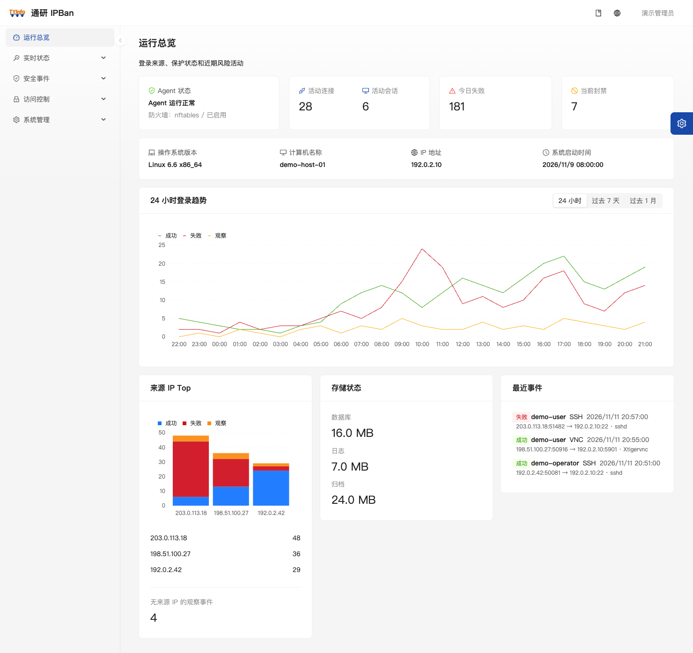
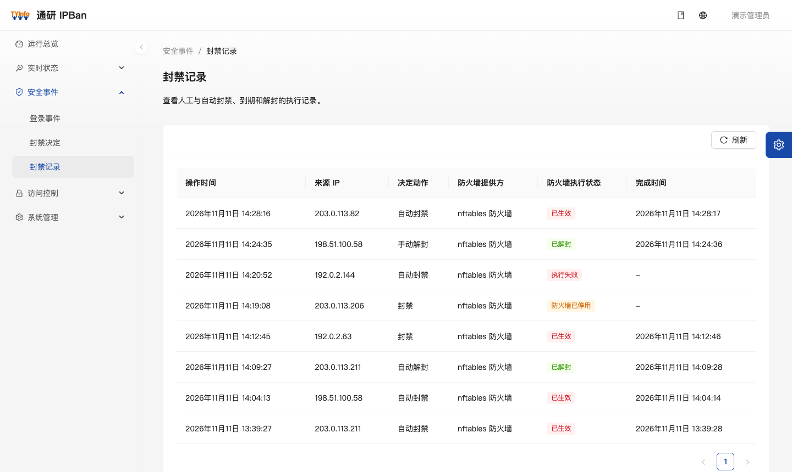
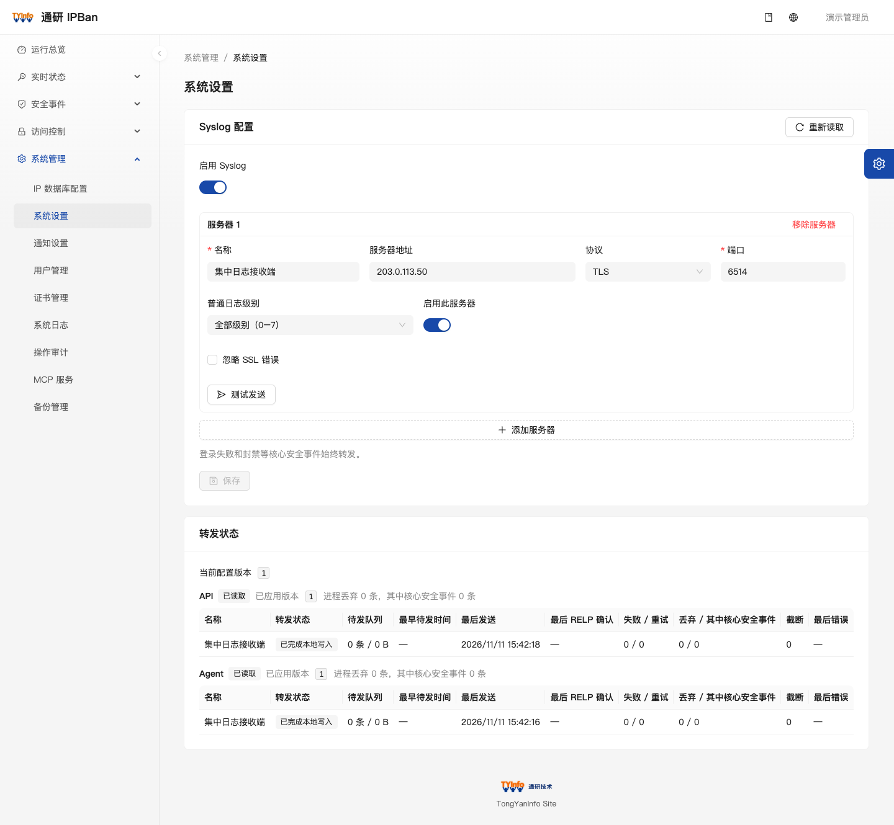
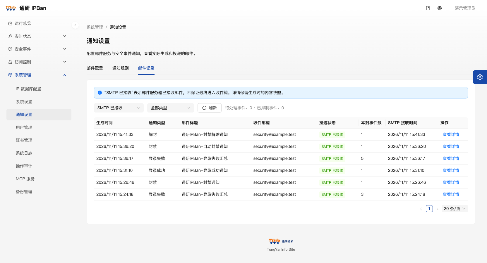

# 通研 IPBan

**通研官网**：<https://www.tongyaninfo.com>　|　**产品官网**：<https://ipban.tongyaninfo.com>

通研 IPBan（Tongyan IPBan）运行在受保护的 Windows 或 Linux 主机上。它采集登录事件，关联来源地址、连接和进程，根据自动封禁策略或人工操作调用本机防火墙，并在管理台展示处置结果。

[文档中心](docs/README.md) · [版本](VERSION) · [变更日志](CHANGELOG.md) · [项目开发约定](AGENTS.md)

## 页面导览

以下截图来自管理台页面，使用合成演示数据。图中的地址、账号、事件和运行状态均为示例。

### 运行总览

查看活动连接、登录会话、今日登录失败次数、当前封禁和防火墙状态。按时间范围查看登录趋势与来源 IP 排名，再进入登录事件或当前连接页核对来源和证据。



### 封禁记录

封禁记录展示来源 IP、动作、执行器、执行状态和完成时间。通过「封禁决定」可以新增单个 IP 或 CIDR 的限时、永久封禁，并解除可操作的记录。执行状态可以区分已生效、执行失败和防火墙停用。



### Syslog 转发

在「系统管理 → 系统设置」添加最多三个接收目标，选择 UDP、TCP、TLS 或 RELP，发送测试日志并查看转发状态。TLS 默认校验服务端证书。日志使用中文正文，主机名采用 `syslog-计算机名`，应用名按业务模块区分。登录成功为 `5·通知`，登录失败和封禁事件为 `0·紧急`。



### 邮件通知

在「通知设置」配置 SMTP，为主机登录成功、登录失败、封禁和解封分别设置通知规则。管理台提供模板预览、测试发送、发送频率限制和历史记录。发送状态「SMTP 已接收」用于确认邮件服务器接收。



## 其他管理功能

| 功能 | 可以做什么 |
| --- | --- |
| 登录事件与实时状态 | 查询登录结果、证据来源和字段完整性，查看当前 TCP 连接和登录会话，对可处置的连接执行下线 |
| 名单与自动策略 | 管理 IP/CIDR 黑白名单条目，配置登录失败阈值、统计窗口、冷却时间和封禁时长 |
| IP 归属地 | 配置解析来源，在相关页面辅助识别来源 IP 所属地区 |
| 运维与审计 | 管理账户和 HTTPS 证书，查询与导出日志，查看操作审计，创建数据库备份 |
| MCP 扩展 | 可选扩展，默认停止；按工具授予 API Key 权限并查看调用审计，需管理员显式启用服务 |

## 运行环境

| 主机 | 登录事件来源 | 防火墙执行器 |
| --- | --- | --- |
| Linux | SSH 和 TigerVNC，取决于主机上的服务及日志配置 | firewalld、ufw、nftables、iptables |
| Windows | Windows Event Log 中可识别的 OpenSSH、RDP 和 WinRM 认证事件 | Windows Defender Firewall |

Agent 负责采集和本机处置。管理 API 提供账号会话和 HTTPS 管理台，通过本机 Unix Domain Socket 或 Windows Named Pipe 访问 Agent。事件、配置和审计存储在 SQLite 中。采集字段完整性与连接下线能力取决于宿主环境。各平台验证范围以 [CHANGELOG.md](CHANGELOG.md) 和实施方案中的验证边界为准。

## 从源码构建

后端使用 .NET 10，SDK 以 [global.json](global.json) 为准。管理台使用 React 19、Umi Max 和 Ant Design Pro，构建需要 Node.js 22 或更新版本及 npm。以下命令在仓库根目录执行。

```bash
dotnet build backend/IpBan.slnx
dotnet test backend/IpBan.slnx --no-build

npm --prefix frontend ci
npm --prefix frontend run lint
npm --prefix frontend test
npm --prefix frontend run build

node scripts/check-docs.mjs
```

在隔离的 Windows 或 Linux 主机上运行时，为 API 和 Agent 配置相同的 `Agent:DataDirectory` 绝对路径及 Unix Socket 路径或 Named Pipe 名称，并使用不同的 WorkerId。先启动 Agent 初始化数据库，再启动 API。将 API 的静态目录指向前端构建产物可提供同源管理台，通过首次启动向导创建管理员。[后端运行说明](backend/README.md) · [前端开发说明](frontend/README.md) · [部署约定](deploy/README.md)

## 发布制品

推送形如 `v0.1.0` 的 tag 会触发 [Release 工作流](.github/workflows/release.yml)：校验 tag 与 `VERSION` 一致后，构建前端静态产物与 win-x64、win-arm64、linux-x64、linux-arm64 四种 RID 的自包含发布包（包内 `api/` 与 `agent/`），生成 `SHA256SUMS.txt` 并汇总为草稿 Release，人工检查后发布。

制品为自包含托管发布，不包含 Native AOT 版本；AOT 制品待 MCP 管理面路由的 AOT 分析问题修复并验证后提供。产物内容、RID 矩阵与发布前检查见[版本与发布约定](docs/releases/README.md)。

## 参考文档

- [项目目录规划](docs/项目目录规划.md)
- [管理 API、邮件通知与 MCP 接口合同](docs/api/README.md)
- [Syslog 转发与日志分级](docs/spec/Syslog转发与日志分级实施方案.md)
- [版本与发布约定](docs/releases/README.md)
- [项目开发约定](AGENTS.md)
