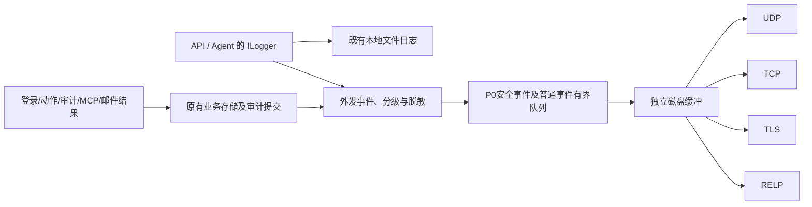

# Syslog 转发与日志分级实施方案

状态：**已完成本地隔离验证，并部署到获准的隔离 Linux x64 环境**。分析日期：2026-11-11。实际验证范围与边界见本文第 10 节和 [ADR-0003](../adr/ADR-0003-Syslog转发与有界缓冲.md)。

## 1. 目标与已确认范围

在“系统管理 → 系统设置”增加 Syslog 配置。启用后，将 **IPBan 全部日志及已经采集的主机登录事件**按统一级别转发到远端 Syslog 服务器。此范围已由用户确认，不扩展到整机所有 Windows EventLog、Linux journald 或其他软件日志文件。

- 协议覆盖 UDP、TCP、TLS、RELP；本项目作为发送端，不新增远程日志接收服务或监听端口。
- TLS 提供“忽略 SSL 错误”复选框，默认不勾选；设置只作用于对应目标。
- 用户已进一步明确确认：**登录失败和封禁事件统一使用 `0·紧急`**。认证失败、认证处理异常、封禁请求、封禁决定及封禁执行结果统一 severity=0，并列入最高转发优先级 P0；覆盖下文的通用 .NET 转换规则。
- 用户指定报文标识：**HOSTNAME = `syslog-计算机名`；APP-NAME 按业务模块区分**，不以 API/Agent 两个进程名代替模块名。
- 覆盖 API、Agent、判定调用、登录采集、防火墙、管理审计、MCP、邮件、IP 归属地、数据库、文件日志等现有逻辑。
- 本地日志和可靠审计继续保留；Syslog 是额外转发通道，不取代原有记录。
- “全部”指来源和事件覆盖；UDP、本地故障和有限缓存均存在丢失边界，不能承诺任意故障下零丢失。
- 启用后处理新产生的日志；不自动外发启用前的历史归档。采集器启用后新识别的登录事件保留其原始发生时间。
- 管理台通常运行在管理员的远程浏览器，浏览器 `console` 不属于被保护主机日志。本次检查其错误处理，但不新增浏览器遥测上传。

截图仅作为协议选项和表单交互参考，其中的地址、端口不是部署参数。当前设置最多支持 3 个目标。

## 2. 实施前源码基线

本次扫描 `backend/src` 中 120 个 C# 源文件，排除 `bin/obj/wwwroot`：Agent 54、API 47、Engine 4、Shared 15。发现 40 个显式运行日志点：Information 7、Warning 24、Error 3、Debug 6，未发现显式 Trace/Critical 点。计数包含 `LoggerMessage` 声明与 `LogX` 调用，不包括框架自动日志及数据库业务记录，也不代表每条分支已动态测试。

| 现状 | 源码依据 | 对方案的影响 |
| --- | --- | --- |
| API、Agent 均已接入公共文件日志 | [API 入口](../../backend/src/IpBan.Api/Program.cs)、[Agent 入口](../../backend/src/IpBan.Agent/Program.cs) | 可共同注册 Syslog Provider，不新增宿主项目 |
| 文件日志默认 Information；先格式化消息，未保留结构化 state/scope | [FileLoggerProvider](../../backend/src/IpBan.Shared/Logging/FileLoggerProvider.cs)、[FileLoggingOptions](../../backend/src/IpBan.Shared/Logging/FileLoggingOptions.cs) | 不能通过尾随 NDJSON 获得完整事件和 Debug 日志 |
| 登录结果、防火墙结果写 SQLite | [登录存储](../../backend/src/IpBan.Agent/Service/impl/SqliteLoginEventStore.cs)、[动作存储](../../backend/src/IpBan.Agent/Service/impl/SqliteFirewallActionStore.cs) | 只增加 ILogger Provider 会漏转发业务事件 |
| 管理审计、MCP 调用、SMTP 发送结果独立存储 | [管理存储](../../backend/src/IpBan.Api/Service/impl/SqliteAdminStore.cs)、[MCP 存储](../../backend/src/IpBan.Api/Service/impl/McpStore.cs)、[通知队列](../../backend/src/IpBan.Api/Service/impl/NotificationService.Queue.cs) | 需要独立于邮件开关的业务事件入口 |
| system_settings 已支持 JSON 配置；通知已有版本校验和事务审计 | [通知配置](../../backend/src/IpBan.Api/Service/impl/NotificationService.cs) | 可复用，无须仅为 Syslog 配置新增表 |
| 系统设置页面存在，但未挂入当前路由 | [设置页面](../../frontend/src/pages/system/settings/index.tsx)、[路由](../../frontend/config/routes.ts) | 正式增加系统设置入口，再放入专用 Syslog 表单 |
| 系统日志页面为原始文本，主要按文件和关键词查询 | [日志页面](../../frontend/src/pages/system/logs/index.tsx) | 追加级别展示时需兼容既有 NDJSON 记录 |

部分 README/AGENTS 的“初始化阶段”“不含 MCP”等状态描述滞后于源码。本方案按真实现存模块分析，不据旧说明排除已存在的逻辑，也不据源码存在推定已部署。

## 3. 系统设置设计

入口确定为“系统管理 → 系统设置 → Syslog 配置”，复用已有设置页面目录，新增有类型表单，不要求用户手填 JSON。沿用通知设置的加载失败保护、草稿保留、版本冲突和测试发送交互。

| 字段 | 设计与默认值 |
| --- | --- |
| 启用 Syslog | 默认关闭；启用时至少有一个有效且启用的目标 |
| 服务器列表 | 建议最多 3 个，各目标独立启用、测试、状态和发送队列；向所有启用目标复制发送，不做随机负载分配 |
| 名称、服务器地址 | 名称用于识别；地址接受域名、IPv4、IPv6，不接受 URL、路径、账号或控制字符 |
| 协议、端口 | UDP / TCP / TLS / RELP；端口 1–65535；新建建议 TLS，端口随协议给建议值，用户已修改的端口不被静默覆盖 |
| 转发级别 | 默认全部 0–7；普通日志可选“Warning 及更严重”等，数字判断为 `severity <= selectedSeverity`；核心安全事件固定转发，不被普通日志等级筛选排除 |
| 忽略 SSL 错误 | 仅 TLS 显示，默认 `false`；离开 TLS 清为 false，切回不自动勾选 |
| 保存、测试发送 | 保存和测试分开；测试针对已保存的单个目标，未保存草稿需先保存；全局停用时仍可显式发测试消息 |

TLS 勾选后只放宽该连接的服务器证书验证，包括证书链、有效期、名称匹配错误；连接仍使用 TLS。无服务器证书、TLS 协商失败、网络失败和算法不兼容不能伪装成功，不自动降级到明文。界面持续提示“已跳过服务器证书校验”，配置变更写审计。默认使用系统信任库；本期不增加客户端私钥上传或 mTLS 配置。

后端重复执行所有输入校验，并限制重复目标、并发测试数与超时。配置和测试要求管理员会话及同源写请求校验；测试不得开放为匿名任意网络探测接口。非 TLS 协议提交该复选框为 true 时明确拒绝。

保存成功显示“配置已保存”，并分别显示 API/Agent 的已应用版本，不能直接显示“服务器接收正常”。加载失败时禁止以空默认值覆盖原配置。测试结果区分：

| 协议 | 可证明的结果 |
| --- | --- |
| UDP | 消息已交给本机网络栈；需要到接收端确认 |
| TCP | 建连和本地写入完成；不证明远端应用接收或落盘 |
| TLS | 证书校验/握手和本地写入完成；不证明远端落盘 |
| RELP | 收到该事务的正向应答；不等于接收端数据库已持久化 |

每个目标展示连接状态、最后本地发送成功时间、最后确认时间（仅 RELP）、积压条数/字节、最老待发时间、失败/重试/丢弃计数、脱敏错误码。UDP 不显示“持续在线”。

## 4. 协议与报文

| 协议 | 建议端口 | 实现要求 |
| --- | --- | --- |
| UDP | 514 | 一条 RFC 5424 消息对应一个 datagram；无应用应答，发送成功后不因“没有 ACK”重复发送 |
| TCP | 514（兼容惯例） | 长连接；默认 RFC 6587 octet-counting；按目标提供 LF 分隔兼容模式，正文换行必须转义 |
| TLS | 6514 | TCP + TLS + RFC 5425 octet-counting；支持 TLS 1.2，优先 TLS 1.3，禁用旧 SSL/TLS 版本 |
| RELP | 2514（建议，可修改） | 真正实现会话协商、事务编号、发送应答、超时与重连；不能以普通 TCP 冒充 RELP |

标准依据：[RFC 5424](https://www.rfc-editor.org/rfc/rfc5424)、[RFC 5426](https://www.rfc-editor.org/rfc/rfc5426.txt)、[RFC 6587](https://www.rfc-editor.org/rfc/rfc6587)、[RFC 5425](https://www.rfc-editor.org/rfc/rfc5425)、[RFC 9662](https://www.rfc-editor.org/rfc/rfc9662.txt)。TCP/514 是实际部署惯例，RFC 6587 未为其指定标准端口。RELP 对接依据 [rsyslog omrelp](https://docs.rsyslog.com/doc/configuration/modules/omrelp.html) 与 [imrelp](https://docs.rsyslog.com/doc/configuration/modules/imrelp.html)；确认丢失后重发可能产生重复。

本期 RELP 指明文 RELP；TLS 下拉项指标准 Syslog over TLS，二者不能混用。RELP over TLS 如有明确需求可扩展为独立能力，不能因已有 TLS 选项就宣称支持。四种协议均属于本次目标，RELP 需单独互操作验证，未验证前不作为可用选项发布。

统一采用 RFC 5424。IPBan 固定使用 `local0`（设施码 16），以 `PRI = 16 × 8 + severity` 编码事件级别。UTF-8 字节长度用于所有长度前缀。消息头包含 UTC 时间、`syslog-计算机名`、按模块指定的 APP-NAME、processId 和稳定事件类型 MSGID。先采用合法的 `STRUCTURED-DATA = -`，MSG 为 UTF-8 JSON（按 RFC 要求处理编码标识），不虚构企业编号注册自定义 SD-ID。

主机名从被保护主机的计算机名读取，例如合成计算机名 `HOST01` 对应 `HOSTNAME=syslog-HOST01`。同一台主机的 API 和 Agent 必须使用同一主机标识；不使用管理员浏览器名称、Syslog 接收服务器名称或来源登录 IP。如果容器内运行，需要从部署配置明确传入被保护主机名称，不把容器随机 ID 当计算机名。配置读取与计算在启动或配置刷新时完成，不每条日志调用系统命令。

APP-NAME 采用如下稳定模块目录，同一模块跨 API/Agent 保持一致；来源进程放 `sourceProcess=api/agent`，模块放 `module`，原始 ILogger category 单列保留。

| 业务模块 | APP-NAME | 典型事件 |
| --- | --- | --- |
| 登录认证 | `ipban-login` | 已采集主机登录和管理台登录，成功为 5，失败为 0/P0 |
| 登录采集 | `ipban-collector` | SSH/VNC/Windows 采集器故障、读取统计、恢复 |
| 封禁 | `ipban-ban` | 人工/自动/MCP 发起的封禁请求、决定和执行结果，统一 0/P0 |
| 解封 | `ipban-unban` | 人工/到期解封请求和结果，成功 5、失败 3，P0 |
| 防火墙 | `ipban-firewall` | Provider 探测、能力、状态、命令执行诊断；封禁业务结果仍归 ipban-ban |
| 名单与策略 | `ipban-policy` | 黑白名单、策略变更、观察/冷却/匹配诊断；形成封禁后归 ipban-ban |
| 连接与会话 | `ipban-session` | 连接/进程关联、当前会话、人工断开 |
| 用户与系统设置 | `ipban-admin` | 管理员账户、普通系统配置变更 |
| 管理审计 | `ipban-audit` | 审计存储自身故障及没有更具体模块的审计事件；不能把全部业务审计重新标成此模块 |
| HTTP 与实时通信 | `ipban-http` | 请求完成、响应异常、SignalR 状态 |
| 本机进程通信 | `ipban-ipc` | Named Pipe/Unix Socket 监听、通信及恢复 |
| MCP | `ipban-mcp` | MCP 服务、Key、工具调用与鉴权；封禁业务事件归 ipban-ban 并用 traceId 关联 |
| 邮件通知 | `ipban-mail` | SMTP 测试、队列、发送成败与通知配置 |
| IP 归属地 | `ipban-geoip` | IP 数据源配置、查询、降级和恢复 |
| 数据库 | `ipban-storage` | SQLite 初始化、迁移、读写故障 |
| 备份 | `ipban-backup` | 创建备份、导出及结果 |
| HTTPS 证书 | `ipban-cert` | 管理台证书加载、上传及有效性问题 |
| 服务运行 | `ipban-runtime` | API/Agent 启停、ID 初始化、一般宿主诊断 |
| 本地日志 | `ipban-logging` | 文件写入、轮转、清理、日志导出 |
| Syslog 转发 | `ipban-syslog` | 配置、合成测试；发送器自身故障仍按防递归规则只记本地状态 |

模块由事件目录和明确的 logger category/scope 映射决定，不用中文消息、用户名或不稳定类名拼 APP-NAME。未匹配类别用 `ipban-other` 并计数，验收要求所有项目自有事件都有明确模块。来源审计与最终动作通过事件类型区分，不因应用名相同而重复发布同一业务结果。

HOSTNAME 最长 255、APP-NAME 最长 48 个 RFC 允许的 ASCII 字符。常规计算机名直接加 `syslog-` 前缀；非 ASCII/不合规字符采用确定性编码，超长时保留前缀及稳定哈希后缀，正文 `computerName` 保留原名称，避免直接删除字符造成不同主机重名。这些边界行为需要单测，不能静默输出无效报文。

JSON 字段建议为 `schemaVersion / eventUid / eventType / occurredAtUtc / computerName / module / sourceProcess / category / runtimeLevel / syslogSeverity / result / traceId / sourceId / protocol / remoteIp / actor / message`，按事件类型选择字段。业务长整数 ID 使用十进制字符串；同一动作的请求、结果、诊断共享关联 ID，但事件类型各不相同。

另外携带 `deliveryPriority` 标记投递顺序，P0 为最高；这是本项目字段，不是 Syslog 报文头的 PRI。PRI 仍按标准由 facility 和 severity 计算。

长度策略：TCP/TLS/RELP 建议初始上限 8 KiB，接收端兼容性实测后调整；UDP 上限按网络 MTU 和接收端能力设置，未知 MTU 时采用 RFC 5426 的保守边界（IPv4 480、IPv6 1180 字节）。先压缩为必要字段，再按 Unicode 边界截短 message，保留合法 JSON、事件 ID 和 `truncated=true`；完整记录保留本地。不能把一条超长 UDP 日志自行拆成多条后声称原文已完整投递。

## 5. 统一日志级别

级别名称采用用户提供的 0–7 列表；**数值越小越严重**。标准 Emergency 表示系统不可用；按用户明确选择，IPBan 对登录失败和封禁事件采用自定义业务映射 severity=0。接收端须结合 eventType/result 判断发生了什么，不把每条此类记录解释为主机已瘫痪。

| 值 | 名称 | IPBan 使用规则 |
| --- | --- | --- |
| 0 | Emergency，紧急 | 按用户确认的项目规则：登录失败/认证处理异常；封禁请求、决定、生效、执行失败和 Disabled，全部使用 0 |
| 1 | Alert，警报 | 必须立即人工处理的明确灾难事件；当前无已定义触发条件，预留 |
| 2 | Critical，严重 | 服务不能启动、核心数据库/可靠审计整体不可用、整个保护处理链停止 |
| 3 | Error，错误 | 其他系统操作失败：落库、解封、最终邮件发送等；登录失败/封禁事件按专门规则使用 0 |
| 4 | Warning，警告 | 服务仍运行但降级、可重试故障、队列压力；认证失败/触发封禁的阈值事件使用 0 |
| 5 | Notice，通知 | 登录成功、启停、配置变更、管理员操作、解封生效 |
| 6 | Informational，信息 | 正常请求完成、邮件发送成功等运行信息 |
| 7 | Debug，调试 | 轮询、心跳、匹配细节、重复证据、正常未命中及诊断信息 |

默认转换：`.NET Trace/Debug → 7`、`Information → 6`、`Warning → 4`、`Error → 3`、`Critical → 2`、`None → 不记录`。**先按事件目录匹配登录失败/封禁等显式规则，再对其他日志使用默认转换**。Notice/Alert/Emergency 通过元数据指定，不解析中文消息猜级别；例如成功封禁可以保留本地 Information，同时明确 `syslogSeverity=0`，不必把 .NET 运行日志全部改成 Critical。

`Success=false`、HTTP 4xx、`FirewallActionStatus.Failed`、事件完整性 Full/IpEnforceable/ObserveOnly 均不能直接等价于 Error。必须结合事件类型、错误码、动作结果与影响范围。单次登录失败即使用 0，连续失败和触发封禁也使用 0，保留次数/窗口/策略字段区分；这表达产品关注优先级，不将其伪写成系统执行故障。其他普通表单校验不因返回失败而变成 0。

这里的“认证失败/认证处理异常”特指已采集主机协议和管理台账户登录。MCP 无效 API Key、没有登录会话的普通接口访问属于独立鉴权拒绝，默认 4，不误套登录失败规则。

默认转发所有已生成事件。生产默认不额外启用高开销 Trace/Debug 诊断；需要时通过独立诊断选项开启。必须同步检查 LoggerFactory、Provider 和 category 过滤，确保新开启的 Debug 不被上游 Information 门槛提前丢弃；文件日志与 Syslog 的过滤相互独立。

登录失败、认证处理异常、封禁请求/决定、封禁执行成功/失败/禁用，以及关联解封结果固定归入 P0；为这些事件预留独立队列和磁盘配额，优先持久化、优先投递，不被普通访问日志或 Debug 占满缓冲。登录失败和封禁使用 severity=0；关联解封保持成功 5、失败 3。统一为 0 不抹平 BanDecision/Applied/Failed/Disabled 的实际状态，必须在 eventType/result 中区分。正常未命中、冷却、重复证据或未产生新动作的幂等跳过是诊断事件，不伪造一条新的“封禁事件”。

## 6. 全模块分析与调整清单

| 模块/逻辑 | 当前问题或特点 | 拟定分级及调整 |
| --- | --- | --- |
| API/Agent 生命周期、ID 初始化 | Agent 启动及 30 秒心跳均为 Information；启动依赖失败缺少明确事件 | 启停 5，心跳 7，就绪 6；不能启动 2，补退出原因和单次状态变化 |
| Linux SSH 采集 | 命令失败、权限异常可能直接返回空事件 | 已启用源首次不可读 4，持续不可读 3，恢复 5；禁用/不适用不告警 |
| Windows EventLog 采集 | 通道缺失、EventLog/权限异常被忽略 | 可选通道未安装 6/7，必需通道不可读 3，部分源暂时故障 4，恢复 5 |
| TigerVNC 采集、解析 | 单源失败有 Warning，普通解析未命中跳过 | 单源暂时失败 4，全部有效源不可读 3；不相关行不记错误，损坏率异常 4 |
| 采集调度、端点/进程关联 | 批次统计 Debug，连接关联失败 Debug | 统计 7；预期进程消失 7，持续影响识别质量 4；入库失败 3 |
| 主机登录认证 | 数据库存储，无逐事件 ILogger 日志 | 成功 5。单次失败、连续失败、认证处理异常及触发封禁均为 0/P0。证据完整性单列 |
| Engine 归一化和判定 | 纯函数，未写日志，属于正确边界 | Agent 调用处记录：观察/未命中/冷却 7，封禁决定 0/P0；Engine 保持无 IO |
| 黑白名单、策略版本/回滚 | 成功写管理审计；不能据此推定封禁实际生效 | 管理变更 5，产生封禁决定 0/P0，其他诊断 7；无效配置/策略不可用 4，系统执行故障 3 |
| 自动封禁、观察期/冷却期 | 单轮评估、断开、到期解封异常均 Warning | 暂态评估失败 4，持续不能评估 3；真实断开/到期解封失败 3，核心链停止 2 |
| 防火墙探测 | Disabled/PermissionDenied 等可能随普通探测以 Information 输出 | Enabled 首次/恢复 5；无法提供保护的状态 4；按状态变化发布，不每次探测刷屏 |
| Windows/firewalld/ufw/nftables/iptables 执行 | 多数结果通过返回值和 SQLite 表达 | 封禁 Applied/Disabled/Failed 全部 0/P0，保留不同结果；解除成功 5/失败 3 且 P0；无新动作的幂等跳过仅诊断 7 |
| 人工封禁/解封 | API 有请求/结果审计，Agent 有实际动作记录 | 封禁请求及结果 0/P0；解封请求/成功 5，执行失败 3 且 P0；同一动作关联，不能重复计成两次封禁 |
| 当前连接/会话及人工断开 | 正常查询不逐条记；人工断开缺专用完整审计 | 正常查询完成 6，明细/关联 7；人工断开请求/成功 5，已结束 6，执行失败 3 |
| IPC 监听与通信 | 多数通信失败统一 Warning | 监听就绪 5，正常断开 7；暂态故障 4，持续不可用 3；关键启动失败 2 |
| 管理登录、退出、初始化、会话 | 入口缺明确安全审计 | 初始化/管理员登录退出 5；认证失败/认证处理异常 0/P0；其他未认证访问 4；补真实 actor、remoteIp |
| 用户/设置/名单/策略审计 | 部分先业务提交后独立写审计，actor 默认 local-admin | 成功变更 5；统一真实操作者、事务内审计；落库失败 3，可靠审计整体不可用 2 |
| HTTP 访问与异常边界 | 框架过滤使普通成功请求不完整；部分 503 仅返回结果 | 增加脱敏请求完成事件：正常 6，普通校验失败 6，安全拒绝 4，5xx 系统故障 3；取消请求不误报 Error |
| SignalR、实时数据、总览 | 轮询失败仅 Debug，未授权连接 Warning | 内部轮询 7，首次/持续服务异常 4，恢复 5；授权拒绝 4；不逐连接快照打印 |
| IP 归属地 | 外部接口成败多为状态/计数；配置异常 Warning | 缓存/逐 IP 诊断 7；外部服务不可用 4、恢复 5；配置审计失败 3 |
| 邮件通知/测试/发送历史 | 结果独立存储，受邮件开关、频率限制和合并影响 | 配置/测试 5，入队/成功 6，可重试失败/背压 4，最终失败 3；Syslog 不受邮件开关控制 |
| MCP 服务/Key/授权 | 管理审计与调用审计分离 | 配置/Key 生命周期 5，读成功 6，其他写成功 5，拒绝 4，执行异常/结果不确定 3；封禁相关事件同样覆盖为 0/P0；绝不输出 Key |
| MCP 审计/清理 | 结果审计失败 Error，清理失败 Warning | 保持 3/4；整体审计不可用 2；不能只按最大 ID 扫描漏掉调用状态更新 |
| SQLite 初始化/迁移/运行写入 | 失败重抛，成功缺少明确领域事件 | 无迁移 7，初始化/迁移成功 5；阻止启动 2，单次写失败 3；不打印连接串 |
| 备份、证书、日志导出/删除 | 部分成功有审计，日志导出缺审计 | 成功 5，输入错误 6/4 按原因；执行失败 3；补导出审计，记录元数据而非内容 |
| 文件日志、轮转/清理 | 同步 Write/Flush，失败吞掉，异常直接 ToString | 写入失败 3，轮转/清理暂时失败 4；补失败/丢弃/最后成功指标；禁止递归自记 |
| Syslog 自身（新增） | 尚未实现 | 配置/恢复 5，短暂断网/重试 4，长期不可达/缓冲写失败 3；只走独立本地诊断和状态计数 |
| 前端请求、错误边界、各业务页面 | ErrorBoundary 只 console.error，页面无统一 severity；部分旧请求合同不一致 | 后端权威分级，前端统一展示；用户 Toast/颜色不决定 Syslog 等级，不重复上传每次点击 |
| Shared DTO、协议规范化、会话投影 | 纯数据/转换逻辑 | 不为每次函数调用加日志，在调用边界输出有意义事件，避免噪声和重复 |

关键源码核对入口：[采集调度](../../backend/src/IpBan.Agent/Workers/LoginEventCollectionHostedService.cs)、[SSH](../../backend/src/IpBan.Agent/Service/impl/LinuxSshLoginCollector.cs)、[Windows EventLog](../../backend/src/IpBan.Agent/Service/impl/WindowsEventLogLoginCollector.cs)、[自动封禁](../../backend/src/IpBan.Agent/Workers/AutomaticBanHostedService.cs)、[防火墙协调器](../../backend/src/IpBan.Agent/Service/impl/FirewallActionCoordinator.cs)、[管理端点](../../backend/src/IpBan.Api/Service/ManagementEndpointExtensions.cs)、[实时轮询](../../backend/src/IpBan.Api/Service/ManagementRealtimeWorker.cs)。

实施时形成稳定事件目录：每类事件定义 eventType、severity、产生位置、结果码、必要字段、去重键、是否需要可靠审计及测试编号。对所有 catch 逐个判断“预期缺失/取消/可恢复异常/真实故障”，不能机械给每个 catch 增加 Error。暂定可恢复后台故障连续 3 轮或持续 60 秒升级为 Error；这是待验证的产品参数，升级和恢复都只发一次状态事件。必需通道权限失败等确定性故障直接按表分级。

## 7. 实现架构、保存与热生效

本地记录保留其原有事务和写入路径；外发入口不重复写业务记录或审计，也不等待 Syslog 成功后再提交本地审计。

- Shared 提供 `SyslogSeverity`、配置/状态 DTO、统一事件、分级、脱敏、格式化和传输接口；沿用 Models/Options/Service/Service/impl/Common 的目录职责，不新建程序集。
- API/Agent 各自注册 Provider 和后台 Worker，各自发送本进程产生的日志；HOSTNAME 统一为 syslog-计算机名，APP-NAME 按上方模块目录确定，sourceProcess 和 PROCID 区分进程；独立缓存和连接，不依赖另一进程在线，不由两进程重复读取同一活动日志文件。
- Provider 只做必要的事件快照和有界入队，不在请求/防火墙线程 DNS、建连、等待重试或逐条查库。业务入口在数据库事务真正提交后发布；回滚不得发布成功事件。
- 登录证据去重成功新增后才发布；防火墙由协调器发布真实结果；API 请求审计不冒充 Agent 已执行；MCP 记录最终状态和 uncertain，邮件不复制 SMTP 凭据或正文。
- Engine 保持纯函数，由 Agent 在调用边界记录判定语义。不使用邮件候选/outbox 代替 Syslog 全量事件源。
- `system_settings` 增加逻辑键 `syslog.settings`，保存有类型 JSON 与 revision，复用通知配置的版本冲突、事务内审计模式。通用 `/settings/{key}` 禁止写 `syslog.*` 绕过校验。
- 区分两种版本：`configRevision` 每次保存变化，用于并发校验和进程应用状态；`deliveryTargetVersion` 只在 host/port/protocol/TLS/framing 等投递语义变化时变化。启停和新事件的级别筛选不改变目标版本，保证重新启用同一目标可续发原积压。
- API 保存后换入不可变配置快照；Agent 每 5 秒以内检查 revision，启动先读取配置，不为每条日志查库。现有文件 Provider 不是热加载，需要专门实现此机制。
- 运行中配置刷新失败则暂停新网络投递，在容量上限内继续按最后有效版本缓冲，并显示“配置状态未知”；恢复后先应用最新停用/改址状态，再决定续发。5 秒是正常条件下的检查周期，不是故障条件下的停用时限保证；已在途消息无法撤回。
- 状态提供 desired/applied revision；状态汇总通过现有 IPC 扩展读取 Agent 状态，Agent 不可达明确显示，不能用 API 成功代替 Agent 生效。
- 启动阶段数据库未就绪时本地日志优先，Syslog 使用有界启动缓冲；只在读取到有效的已启用配置后发送。配置读失败不能默认为启用，也不能使用未知目标外发。

拟新增接口均采用 `ApiResult<T>`，业务 ID/revision 字符串化，JSON 源生成保证 AOT：

| 接口 | 职责 |
| --- | --- |
| `GET /api/admin/v1/syslog/settings` | 配置及 revision |
| `PUT /api/admin/v1/syslog/settings` | 校验、并发控制、配置与审计同事务保存；冲突 HTTP 409 |
| `POST /api/admin/v1/syslog/test` | 指定已保存目标及 revision，发送带 testId 的合成事件，返回实际协议阶段结果 |
| `GET /api/admin/v1/syslog/status` | API/Agent 已应用版本、逐目标传输和队列指标；部分不可用显式标注 |

配置保存只验证格式和约束，不因接收端暂时离线拒绝保存；连通性由显式测试和运行状态表达。测试错误使用固定错误码与脱敏摘要，不返回堆栈、私钥或原始网络异常全文。

## 8. 缓冲、重试与数据边界

本期建议使用**有界内存队列 + 独立磁盘缓冲**，不因增加转发而先改数据库结构。API/Agent 按进程、目标 ID、目标版本分隔缓冲；不能把既有普通日志文件当可靠发送队列。分段文件、游标和完整性校验支持进程重启后恢复已落盘的待发记录。

初始建议每进程内存 10,000 条且最多 32 MiB、每目标每进程磁盘 128 MiB，同时设置**每进程全局磁盘上限 384 MiB**，覆盖当前、停用、已移除目标和历史版本的全部缓冲，避免反复更换目标突破容量限制；两进程总上限约 768 MiB。待发最多保留 24 小时。这些是待压测的设计初值，不是已测容量。内存与磁盘均至少预留一半给 P0，普通日志不能占用预留空间，P0 可借用剩余空间。

磁盘按块批量写入，记录先落盘再进入发送流程；采用加权调度，在 P0 优先的同时保留少量普通日志发送份额，防止持续攻击导致运维故障信息永久饥饿。优先调度发生在下一个完整消息/RELP 事务边界，不能把 P0 字节插入已经开始发送的普通帧；每次发送有超时。P0 保留配额包含在全局上限内，不额外无界扩展。

1. 每目标独立 worker、超时和带抖动退避，建议从 1 秒递增到最多 60 秒；只在待发保留期内重试，持续失败可见，不形成无界任务。
2. 先保障 P0 认证失败/封禁事件，再保障其他审计和 severity 0–4；容量紧张先舍弃 Debug、普通访问诊断等低优先级事件，再按明示策略淘汰其他事件。Notice 不等于低价值，保留优先级独立于数字级别。持续攻击也可能耗尽 P0 空间；此时仍不能承诺永不丢失，必须单独显示 P0 丢弃数、首末时间和原因，不静默降级为普通日志。
3. 普通运行日志允许有界丢弃；远端不可用不阻断登录采集、封禁或管理业务。可靠本地审计不可用时仍按原要求失败，不能因 Syslog 发送成功就假报管理操作成功。
4. UDP 只重试明确的本地发送失败；TCP/TLS 写成功不具备应用级确认，连接中断边界可能丢失或重复；RELP 未确认消息重发，不承诺 exactly-once。eventUid 首次构建事件时固定，业务事件结合来源 ID 与事件类型生成，运行事件使用唯一 ID，重试保持不变以供接收端去重。
5. 全局或单目标停用后取消新投递并停止该目标发送，保留待发记录至保留期；同一目标及版本重新启用可续发。更换地址/协议/TLS 安全设置形成新目标版本，旧队列暂停且不能自动流向新地址；页面显示旧积压和到期处置。
6. 级别过滤只作用新事件；已入队事件按原目标版本处理。新目标默认不回放历史。手动清空缓存作为独立危险操作设计，不在本轮执行任何文件删除。
7. 缓冲丢失、截断、磁盘满、游标损坏和重放均需要指标；关闭时限时 flush，不能声称断电前所有内存事件都已落盘。发送器自己的故障不进入同一转发队列，避免递归日志风暴。

**可靠性限制必须验收并说明**：业务提交后到入队之间、内存入队到磁盘落盘之间存在进程崩溃丢失窗口。本方案满足全来源覆盖和有界断网缓冲，不提供“业务提交与待发送记录原子提交”。若要求审计/安全事件在这些窗口也不漏转发，则升级为 SQLite transactional outbox：业务记录、审计、待发送事件同事务提交，逐目标记录发送进度。该升级需要新增表/索引与迁移方案，须另行明确批准数据库结构变更；RELP 和 outbox 也不能保证接收端最终落库。

脱敏统一放在外发入口：保留业务必要的来源 IP、协议、动作、操作者和结果；禁止密码、Cookie、Authorization、API Key、SMTP 凭据、PFX/私钥、连接串、邮件全文、原始请求/响应正文。异常只记录类型、固定错误码和经过白名单筛选的描述；普通访问记录路由模板与状态，不记录完整 query/headers/body。日志字段长度受限，转义换行和控制字符，避免伪造多条消息。不得通过“忽略 SSL 错误”绕过这些规则。

## 9. 实施顺序与影响范围

1. **事件目录与日志治理**：固定全部模块的事件类型和分级；补认证、采集失败、真实防火墙结果、可靠审计、请求完成等缺口；修正心跳和幂等结果级别。大范围改动按模块提交评审，不一口气替换全仓 logger。
2. **公共事件与发送基础**：结构化字段、脱敏、双入口、过滤规则、指标、有界缓冲、崩溃恢复；本地现有日志格式新增字段时兼容旧行。
3. **协议实现与互操作**：UDP/TCP/TLS 及 RELP 都要完成；RELP 先做协议验证，再决定采用经验证的 AOT 兼容库或受控托管实现，不未验证就新增依赖或承诺平台支持。
4. **系统设置、API 与热加载**：挂载设置路由，专用表单、TLS 默认值、并发保护、测试发送、逐目标状态；中英文文案；日志页增加 Syslog 等级展示与筛选，保留原始记录入口。
5. **隔离验证与交付**：覆盖故障场景后更新接口合同、说明文档和版本记录；部署需明确目标环境和动作授权，本方案不沿用历史部署授权。

预计涉及 Shared Models/Options/Logging/Service/Common、API 设置/审计/后台任务、Agent 采集/协调器/后台任务/IPC、前端 routes/settings/logs/services/locales 和各层测试。纯 Engine 算法不改，仅在调用边界记日志。当前建议版不新增数据库表、不修改密钥、不安装全局依赖。

## 10. 验证与验收

| 验证范围 | 必须证明的结果 |
| --- | --- |
| 分级与完整性 | 每个模块至少一组成功/业务拒绝/系统失败事件；40 个原有日志点和补充事件均有分级决定；登录失败/封禁必须为 0，其他事件不被误套专门规则，1 保留 |
| 业务语义 | 判定、Applied、Failed、Disabled、Removed 分开；幂等命中不误报错误；数据库事务回滚不发成功；登录重复证据不重复计数 |
| 格式 | PRI、UTC、UTF-8 字节长度、中文、换行、异常文本、长消息、截断标识与 JSON 合法性 |
| 主机与应用名 | 同机 API/Agent 均为 syslog-计算机名；各业务模块 APP-NAME 正确且稳定；封禁结果不能误归通用 API/Agent 或审计模块；验证名称字符和长度边界 |
| 协议 | UDP 单报文，TCP 拆包/粘包及两种 framing，TLS 正确证书/过期/名称不匹配/不信任链，RELP 协商/应答/超时/重连/重复 |
| TLS 复选框 | 新建和缺省 false；切换协议不遗留 true；仅该目标生效；不把协商/网络故障当证书错误忽略；无明文回退 |
| 隔离与性能 | 多目标之一故障不影响其余；无网络 IO 阻塞业务线程；积压/磁盘配额/限速/优先级丢弃可观察；对比启用前后的请求与采集延迟 |
| 最高优先级 | 验证主机登录失败、管理登录失败、人工/自动/MCP 封禁的决定及成功/失败/Disabled 均为 0/P0；普通拥堵时有预留容量并优先发出；普通级别筛选不排除 P0；P0 自身耗尽时单独暴露丢弃 |
| 重启与配置 | 落盘前/后分别模拟终止；恢复已落盘队列；版本冲突、热加载、禁用、换目标、旧队列处置不串目的地 |
| 故障与安全 | DNS/超时/拒绝连接、磁盘满/权限、审计不可用、发送器递归、日志注入、秘密脱敏；测试接口鉴权/同源校验/限流 |
| 前端 | 主要宽窄视口、空态、加载失败不能覆盖、保存失败保留输入、四协议测试文案、各进程应用版本、部分目标异常 |
| 平台与 AOT | Windows/Linux managed 与 Native AOT 的序列化、Socket、TLS、RELP 和缓冲恢复；一端测试通过不推定另一端通过 |

实施后运行真实现存命令：`dotnet build backend/IpBan.slnx`、`dotnet test backend/IpBan.slnx`；前端目录运行 `npm run lint`、`npm run test`、`npm run build`；相应目标平台执行 Native AOT publish 冒烟；文档运行 `node scripts/check-docs.mjs`。协议端到端使用获准的隔离接收器和合成事件，不连接生产 Syslog、不执行真实防火墙封禁。

当前实现采用多目标上限 3、新目标默认 TLS、默认转发已生成的所有级别，以及有界磁盘缓冲。开启项目诊断时，可通过宿主配置的 `Logging:IpBanSyslog:LogLevel:IpBan` 设置 Syslog Provider 的项目类别级别，不必降低文件 Provider 的阈值。验证结果和仍需跨平台检查的事项见本文第 10 节。
